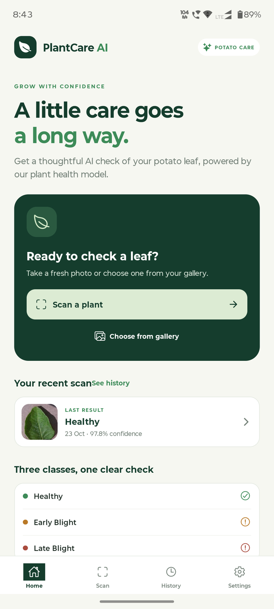
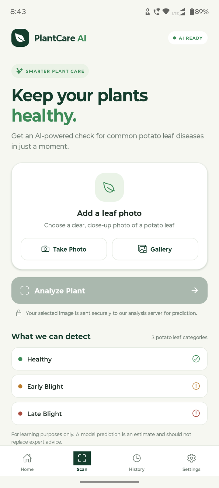
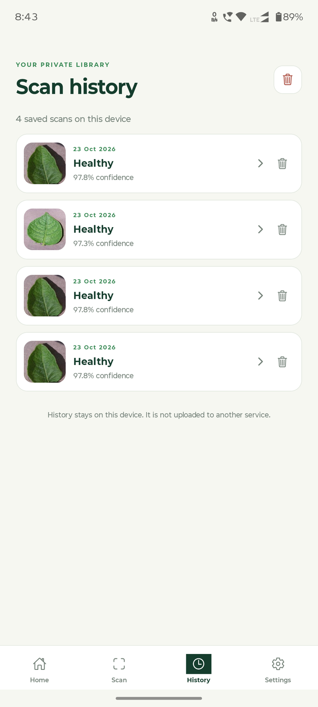
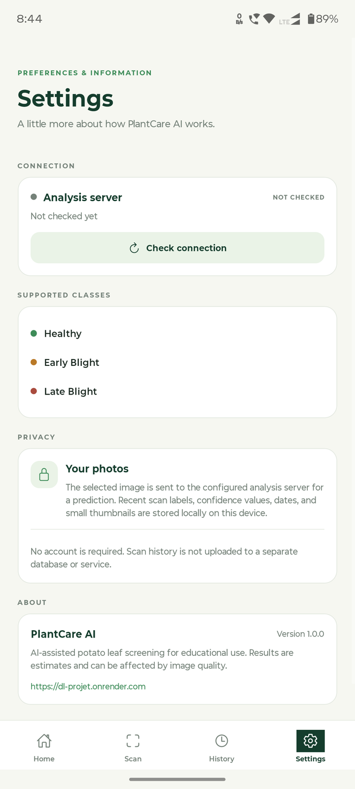
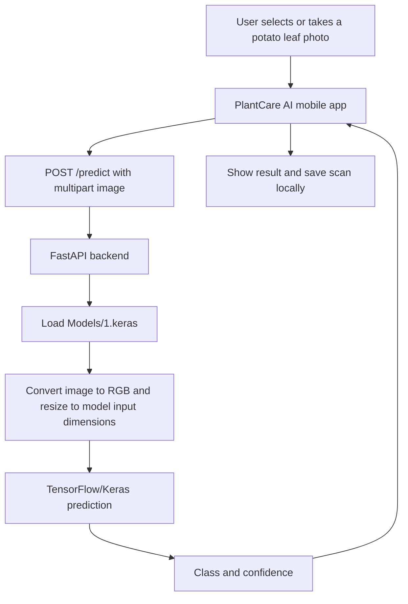

# 🌿 PlantCare AI — Plant Disease Detection App

PlantCare AI is a React Native mobile app that lets users submit a potato-leaf photo and receive an AI model prediction for one of three categories: **Healthy**, **Early Blight**, or **Late Blight**. The app uses an Expo + React Native frontend and a Python FastAPI backend running a TensorFlow/Keras model.

> **Important:** Predictions are estimates from a machine-learning model, intended for educational purposes. They are not a definitive plant-health diagnosis and should not replace advice from an agricultural expert.

<p align="center">
  
</p>

<p align="center">
  <a href="https://github.com/DEVELOPER-MANISH007/Plant-Village-Mobile-APP"></a>
  
  
  
  
</p>

## ✨ Features

- **Leaf image input:** Take a photo with the camera or choose an image from the gallery.
- **AI prediction:** Send an image to the FastAPI service and display the returned class and confidence.
- **Prediction result view:** Review the selected image and the model's result.
- **On-device scan history:** Save recent results and thumbnails locally; view details or delete individual scans and clear history.
- **Connection check:** Test whether the analysis API responds.
- **Mobile-first interface:** Home, Scan, History, and Settings tabs built with Expo and React Native.
- **Request handling:** User-facing messages for network, timeout, and API-response errors.

## 📱 App Screenshots

PlantCare AI includes a simple, mobile-first interface for checking potato leaf health, reviewing predictions, managing scan history, and checking API connectivity.

| Home | Scan |
|---|---|
|  |  |

| Scan History | Settings |
|---|---|
|  |  |

These screenshots are captured from the running mobile app. Predictions are estimates for educational use and may be affected by image quality.

## 🧰 Tech stack

| Area | Technology |
|---|---|
| Mobile app | React Native 0.81, Expo SDK 54, Expo Router |
| Language | TypeScript |
| UI icons | Expo Vector Icons |
| Local scan history | AsyncStorage and app-private file storage |
| API | FastAPI, Uvicorn, Python |
| Machine learning | TensorFlow / Keras CNN |
| Image processing | Pillow, NumPy, TensorFlow image resizing |
| API payload | Multipart form upload |

## 🏗️ Architecture



The mobile app uses the configured API base URL. By default, it points to the deployed endpoint documented in `mobile/src/constants/config.ts`. Scan history is stored on the device; it is not sent to a separate history service. Images selected for analysis are sent to the prediction API.

## 🌱 Supported classes

The backend maps the model's three output positions to these labels:

| Class | Meaning |
|---|---|
| **Healthy** | The model did not select either configured blight class for this image. |
| **Early Blight** | The model selected the Early Blight class. |
| **Late Blight** | The model selected the Late Blight class. |

The backend class order is configured in `api/main.py` as `Early Blight`, `Late Blight`, and `Healthy`. The model must return three outputs for this mapping.

## 📁 Repository structure

```text
Plant-Village-Mobile-APP/
├── Models/
│   ├── 1.keras                    # Model loaded by the FastAPI API
│   └── plant_disease_model.h5     # Additional saved model artifact
├── api/
│   ├── main.py                    # FastAPI routes and prediction logic
│   ├── requirements.txt           # Backend dependencies
│   └── README.md                  # Backend deployment notes
├── mobile/
│   ├── app/                       # Expo Router app entry and layout
│   ├── assets/                    # App icons
│   ├── src/
│   │   ├── components/            # Scan / plant-care screen
│   │   ├── constants/             # API URL and UI constants
│   │   ├── screens/               # Home, History, Settings
│   │   ├── services/              # API client and local scan history
│   │   └── types/                 # TypeScript data types
│   ├── .env.example               # Example mobile API configuration
│   ├── app.json                   # Expo app configuration
│   └── package.json               # Mobile dependencies and scripts
├── ex.ipynb                       # Project notebook
├── main.ipynb                     # Project notebook
├── requirements.txt               # Python dependencies
└── README.md
```

## ⚙️ Prerequisites

- Git
- Node.js LTS and npm
- Python version compatible with the installed TensorFlow release
- Expo Go on an Android device for quick testing, or an Android emulator
- Internet access when using the deployed API

The mobile app and backend can be run independently. If using the hosted API, you do not need to run the Python backend locally.

## 🚀 Run the mobile app

Open a terminal in the repository's `mobile/` directory:

```powershell
cd mobile
npm install
npx expo start
```

Scan the QR code with Expo Go, or start an Android emulator and run:

```powershell
npm run android
```

Available scripts from `mobile/package.json`:

- `npm run start` — start the Expo development server.
- `npm run android` — start the app on an Android emulator.
- `npm run typecheck` — run the TypeScript compiler without emitting files.
- `npm run export` — export the app for Android.

To check TypeScript:

```powershell
npm run typecheck
```

## 🖥️ Run the FastAPI backend locally

From the repository root, create and activate a virtual environment (Windows PowerShell example):

```powershell
python -m venv .venv
.\.venv\Scripts\Activate.ps1
python -m pip install --upgrade pip
pip install -r api/requirements.txt
```

Confirm that `Models/1.keras` exists, then start the API from the repository root:

```powershell
python -m uvicorn api.main:app --host 0.0.0.0 --port 8000
```

Useful local endpoints:

- API overview: [http://127.0.0.1:8000/](http://127.0.0.1:8000/)
- Health / connection check: [http://127.0.0.1:8000/ping](http://127.0.0.1:8000/ping)
- Interactive API docs: [http://127.0.0.1:8000/docs](http://127.0.0.1:8000/docs)

The backend loads `Models/1.keras` at startup. If the model file is missing, incompatible with the installed TensorFlow version, or has an output count other than three, startup will fail.

## 🔌 API reference

### `GET /`

Returns a short API status message and the available endpoint paths.

### `GET /ping`

Returns a simple response used by the app's Settings connection check.

Example response:

```json
{
  "message": "hello, I am live"
}
```

### `POST /predict`

Accepts an image as a multipart form field named `file`.

Example request:

```bash
curl -X POST "http://127.0.0.1:8000/predict" \
  -F "file=@potato-leaf.jpg"
```

Example response shape:

```json
{
  "class": "Healthy",
  "confidence": 0.97
}
```

The values above are illustrative only, not a guaranteed prediction. The backend returns the selected class and the maximum model output as a confidence value. Invalid image uploads return HTTP 400; a missing required file can be rejected by FastAPI validation.

## 🔧 Configure the API URL

The app reads `EXPO_PUBLIC_API_URL` and uses the deployed API URL by default.

1. Copy `mobile/.env.example` to `mobile/.env`.
2. Set `EXPO_PUBLIC_API_URL` to the **base URL only** (do not add `/predict` or `/ping`).
3. Restart Expo after changing the environment variable.

Examples:

| Where the app runs | Example base URL |
|---|---|
| Use deployed API | `https://dl-projet.onrender.com` |
| Android emulator with backend on your computer | `http://10.0.2.2:8000` |
| Physical phone on the same Wi-Fi as the computer | `http://YOUR_COMPUTER_LAN_IP:8000` |
| iOS simulator with backend on the same Mac | `http://127.0.0.1:8000` |

For a physical phone, both devices must be on the same network and the computer firewall must allow the backend port. Replace `YOUR_COMPUTER_LAN_IP` with the computer's local IP address. Use HTTPS for a publicly hosted backend. Do not put passwords or private API keys in Expo public environment variables; values prefixed with `EXPO_PUBLIC_` are bundled into the client app.

## 📦 Build an Android APK

The mobile folder includes EAS configuration. To create a cloud Android build:

```powershell
npm install --global eas-cli
eas login
eas build --platform android --profile preview
```

EAS may ask you to sign in, link the Expo project, or configure Android signing. Review the prompts before proceeding.

## 🧯 Troubleshooting

- **Cannot reach the API:** Confirm the API base URL, internet / Wi-Fi connection, and whether the backend is awake. Hosted free services may take time to start.
- **Android emulator cannot reach localhost:** Use `http://10.0.2.2:8000` for a backend running on the host computer.
- **Physical phone cannot reach local API:** Use the computer's LAN IP, keep both devices on the same Wi-Fi, bind Uvicorn to `0.0.0.0`, and check firewall rules.
- **Model file not found:** Run the backend from the repository root and verify `Models/1.keras` exists.
- **TensorFlow install or model-load error:** Use a Python version supported by the TensorFlow version available for your operating system, and verify the saved model is compatible.
- **Image rejected:** Try a clear, well-lit photo of a single potato leaf in a supported image format.
- **Changes to API URL do not apply:** Restart Expo after editing `mobile/.env`.

## 🗺️ Future improvements

- Add verified, real-device screenshots and a short demo video.
- Add automated tests for API validation and prediction handling.
- Document model evaluation metrics using measured results.
- Add more plant species and disease classes only after training and evaluating a suitable model.
- Improve deployment and monitoring documentation.

## 🤝 Contributing

Contributions and suggestions are welcome.

1. Fork the repository.
2. Create a feature branch.
3. Make a focused change and test it.
4. Open a pull request describing the change.

## 📄 License

No repository license file was verified when this README was prepared. Until a license is added, do not assume the code is available for unrestricted reuse. Add a `LICENSE` file if you want to publish the project under a specific license.

## 👨‍💻 Author

**Manish Kumar**

- GitHub: [@DEVELOPER-MANISH007](https://github.com/DEVELOPER-MANISH007)
- Project repository: [Plant-Village-Mobile-APP](https://github.com/DEVELOPER-MANISH007/Plant-Village-Mobile-APP)

---

If you find the project useful, consider starring the repository.
